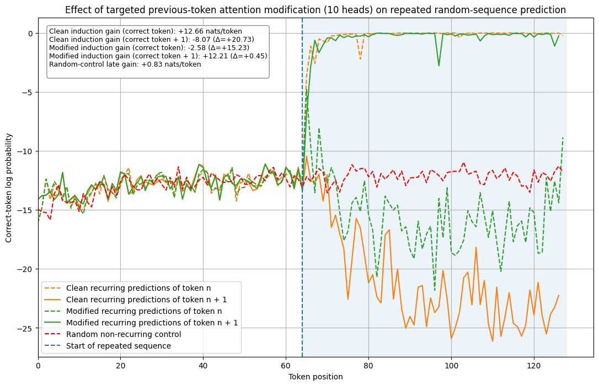

# Mechanistic Interpretability Projects
##### Author: Wolf Gautier
##### Last edit: 05/10/2026
---
This repo contains a series of mechanistic interpretability investigations I built as a way to get myself up to speed with the field as is, meant to double as both learning material and small-scale interpretability research projects. It consists of a set of notebooks that can be ran as is in Colab, which each cover a main concept and corresponding sub-modules and -questions and are meant to walk someone unfamiliar with the covered concepts (but with some background in ML and python) through them, holding a general narrative working towards answering a main question or introducing a main concept while introducing each sub-module with its relevance to the theme as a whole. The notebooks cover both current frontier methodologies such as SAE's and some less current concepts such as induction circuits, which are leveraged as case studies to become familiar with a general MI research workflow and frameworks like [TransformerLens](https://transformerlensorg.github.io/TransformerLens/) and [SAELens](https://github.com/decoderesearch/SAELens).

## Contents
The currently available notebooks are:

--- 

#### Transformer from scratch
This notebook intros the transformer architecture as a whole by implementing it in torch and then loading GPT-2 weights into an instance of this from-scratch transformer. It formally introduces key components such as the attention mechanism, and for demonstration purposes implements them on a linear-algebra level using the einops library. It then samples from this model while introducing different sampling methods, introducing concepts such as temperature and top-k and top-p sampling and illustrating differences between them. It additionally provides a first look at attention pattern visualisation using the circuitsvis library.

---

#### Identifying, validating, and steering induction circuits in GPT-2 Small with TransformerLens

> **Mini research question:**
> Can targeted modification of candidate upstream heads meaningfully steer model induction behaviour to predict deliberately chosen alternative tokens?

This notebook introduces the TransformerLens library and important components of it such as hooks. It does so by identifying, validating and steering induction circuits in GPT-2 Small, having the model predict deliberately chosen alternative tokens.

Concretely, the following steps are performed, discussed and illustrated:

1. **Establish induction behaviour:** Induction behaviour is identified by illustrating the model is able to predict recurring sequences of random tokens by feeding it a sequence containing a random sequence twice as $[BOS, T_{rand}, T_{rand}],$ where $T_{rand}$ is a sequence of tokens of length $n$ randomly sampled from `model.vocab_size`, and showing it predicts the second sequence of tokens well despite it being random. 
2. **Identify candidate heads:** This behaviour is then formalised and hypothesised to be a potential result of composition between previous-token heads and duplicate-token heads, and hooks are used to identify heads displaying one of those attention patterns or an induction attention pattern as $\text{attn}\space t_{\space i\space >\space n_{rec}} \rightarrow t_{\space i \space - \space n_{rec} \space+\space 1}$ using hooks. Metrics are derived to quantify these behaviours and the top $n$ heads with the highest metrics are identified for each category.
3. **Test causal/logit relevance:** Validation of both the found induction heads and the proposed composing heads is performed through DLA and through quantifying changes in the induction behaviour observed earlier under targeted mean-ablation of combinations of induction heads and suspected composition heads. It is found and quantified that induction behaviour degradation under duplicate-token head ablation is negligible while ablation of the top 5 induction heads is enough to almost fully remove the behaviour (the difference in induction gain $\Delta \text{nats/token} \approx -12.00$ compared to no ablation), and that ablation of the top-5 previous-token heads provides a lesser but significant performance degradation. 
4. **Steering induction:** Having identified that induction heads meaningfully contribute to logits under prediction of repeated random sequences and that previous-token heads do seem to play a role in the models induction (head) behaviour, a targeted intervention is performed: we use hooks to modify the attention pattern of the top $n$ previous-token scoring heads to move attention mass from the expected previous-token positions to positions with an offset of $o$ for the tokens corresponding to the first occurrence of the repeated sequence. We show that this effectively allows for a "rerouting" of the induction behaviour from predicting the token occurring after the current token in the previous sequence occurrence to predicting a deliberately chosen alternative, namely the token we made the previous-token heads attend to at offset $o.$ We then perform a grid search over different offsets as well as different numbers of modified heads, showing that the behaviour generalises.